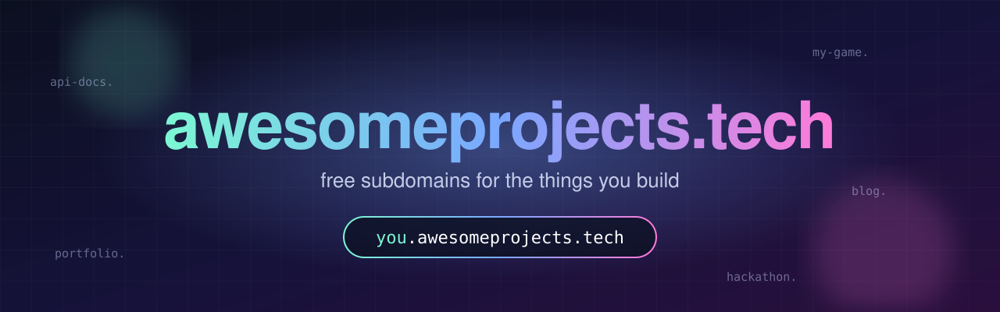
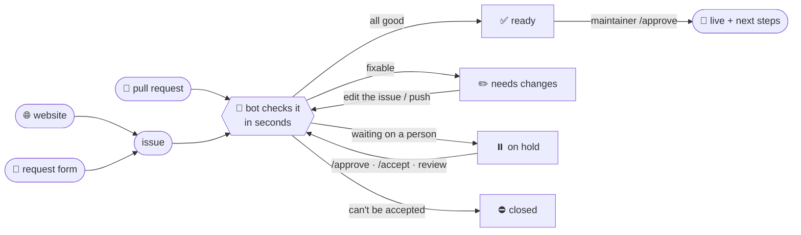

<p align="center">
  
</p>

<p align="center">
  <a href="https://awesomeprojects.tech"></a>
  <a href="https://github.com/So10-k/awesomeprojects.tech/actions/workflows/deploy.yml"></a>
  <a href="domains/"></a>
  <a href="https://github.com/So10-k/awesomeprojects.tech/issues?q=is%3Aopen+label%3Arequest"></a>
</p>

<p align="center">
  <b>Got a project? Give it a name.</b><br>
  Get <code>yourname.awesomeprojects.tech</code> in about a minute: no fork, no JSON, no DNS knowledge.<br>
  Point it at GitHub Pages, Vercel, Netlify, Cloudflare Pages, Render, Railway, Fly or your own server.
</p>

<p align="center">
  <a href="https://awesomeprojects.tech"><b>🌐 Claim a name</b></a> ·
  <a href="#-host-your-repo"><b>Host your repo</b></a> ·
  <a href="#-talk-to-the-bot"><b>Commands</b></a> ·
  <a href="#-change-transfer-or-remove-yours"><b>Transfer / remove</b></a> ·
  <a href="#-rules"><b>Rules</b></a> ·
  <a href="#-faq"><b>FAQ</b></a>
</p>

---

## 🚀 Get your subdomain

### The easy way (recommended)

1. Go to **[awesomeprojects.tech](https://awesomeprojects.tech)**, type a name, and see instantly whether it's free.
2. Pick where your project lives. For a **GitHub repo**, it shows the repo and how it'll be built.
3. Press **Open my request on GitHub**, then **Create**. That's an issue, already filled in.

No website? Use the **[request form](../../issues/new?template=request.yml)** directly. It's the same thing.

Within seconds the bot replies on your issue with every check, a preview of your record and, for repos, the build plan:

> ## ✅ Ready to go live: `alice.awesomeprojects.tech`
> | | Check | Result |
> |:-:|---|---|
> | ✅ | **Format & records** | Valid |
> | ✅ | **Account age** | 4 years old |
> | ✅ | **Subdomains you own** | 1 of 3 |
> | ✅ | **Repository** | alice/portfolio is yours |
> | ℹ️ | **Repository** | Builds as **Next.js** |
> | ✅ | **Target is live** | `alice.github.io` resolves |

Once a maintainer approves it, the bot writes your record, DNS goes live in about a minute, and the issue closes with your **next steps** (for repos: a one-click deploy workflow). Made a typo? Just **edit the issue**, and the bot re-checks.

<details>
<summary><b>The pull request way (for people who like JSON)</b></summary>

[Create `domains/<name>.json`](../../new/main/domains?filename=yourname.json) in your browser (GitHub forks for you):

```json
{
  "owner": { "github": "your-github-username" },
  "description": "My portfolio",
  "records": { "CNAME": "your-github-username.github.io" },
  "site": { "provider": "github-pages", "repo": "your-github-username/portfolio" }
}
```

`site` is optional (it's what the website and `/whois` show). Record types: `CNAME` (alone), `A`, `AAAA`, `TXT`, `MX`; public IPs only, no wildcards. Want to run the zone yourself? [Delegate it to your own nameservers](docs/DNS.md) (`NS`, optionally signed with `DS` for DNSSEC). The bot reviews PRs exactly like requests.

</details>

---

## 🏠 Or let us host it

Pick **"Host it for me"** and choose a starter: **Plain HTML, Next.js, Vite + React, Astro or Docs**. You get a private repo on our own GitHub server, already live at `yourname.awesomeprojects.tech`. Push HTML, or a Next.js / Vite / Astro / SvelteKit project, and it's rebuilt and live a minute later. Each commit shows whether it went live; if a build fails, the error is right there on the commit.

You get an **enterprise account** for it automatically, linked to your GitHub account. Sign in at [github.samsprojects.xyz](https://github.samsprojects.xyz/login) with **Sign in with SAML**, confirming it's you on GitHub; there's no new password. At **[My domains](https://awesomeprojects.tech/me/)** you can see your deploys, redeploy, add a collaborator or two, and manage your DNS records.

## 🛠️ Host your repo

Pick **"My GitHub repo"** and your repo is built and hosted on GitHub Pages for free, on every push:

| | |
|---|---|
| **Next.js** | built as a static export (API routes/SSR? pick **Vercel**) |
| **Vite · Astro · SvelteKit · Nuxt · Gatsby** | detected and built |
| **Docusaurus · VitePress · Eleventy · CRA** | detected and built |
| **Plain HTML** | served as-is |
| **Monorepos, custom commands** | an `awesomeprojects.json` in your repo |

The bot gives you a one-click link that adds a 15-line workflow to your repo. Everything else is in **[docs/HOSTING.md](docs/HOSTING.md)**.

---

## 🤖 Talk to the bot

Start a comment with a command, in any issue or pull request here. The read-only ones also work in [Discussions](../../discussions).

| Command | What it does |
|---|---|
| | **Prefer buttons?** [My domains](https://awesomeprojects.tech/me/): sign in with GitHub to change targets, add TXT records, verify, transfer or remove. |
| `/available <name>` | Is a name free? (with a link to request it) |
| `/whois <name>` | Who owns a name, where it points, what's under it |
| `/mine` | Your names |
| `/verify <name>` | Check DNS and HTTPS right now, with a hint if something's off |
| `/txt <name> <label> <value>` | Add a verification TXT under your name, e.g. `/txt alice _vercel vc-domain-verify=…`. Live in a minute. |
| `/remove <name>` | Remove one of your names |
| `/transfer <name> @user` | Start handing a name to someone |
| `/recheck` · `/cancel` | Re-run the checks · close your own request |
| `/approve` · `/accept` | Allow a name under yours · accept a name handed to you |
| `/stats` · `/help` | Numbers · the full list, including maintainer commands |

Every change the bot makes is posted to the **[📜 Bot activity log](../../discussions/categories/announcements)**.

---

## 🧭 How a request flows



| Check | ✅ Passes when | ⏸️ Holds when | ✏️ / ⛔ Fails when |
|---|---|---|---|
| **Format & records** | valid | | ✏️ bad records, private IPs, reserved names |
| **Ownership** | it's yours | | ⛔ editing someone else's name |
| **Account age** | over 30 days | 7–30 days | ⛔ under 7 days (it tells you when to come back) |
| **Bot check** | looks like a person | looks like a throwaway | ⛔ bot accounts |
| **Subdomains you own** | within your limit | | ✏️ over it |
| **Name check** | | sounds like phishing (`login`, `paypal`…) | |
| **Repository** | public, yours (or your org's) | org membership isn't public | ✏️ missing, archived, someone else's |
| **Target is live** | resolves | a github.io that isn't yours | ✏️ doesn't exist |
| **Consent** | none needed / given | under someone else's name · a hand-over | |

---

## 🔁 Change, transfer or remove yours

| I want to… | Do this |
|---|---|
| **Point it somewhere else** | [My domains](https://awesomeprojects.tech/me/) → *Change where it points* (live in a minute if it passes the checks), or [request it again](../../issues/new?template=request.yml) with the same name |
| **Add a verification record** | `/txt <name> <label> <value>` on any issue |
| **Give it to someone** | `/transfer <name> @them`, or [open a transfer](../../issues/new?template=transfer.yml). They reply `/accept`. |
| **Get a name someone else has** | [Open a transfer](../../issues/new?template=transfer.yml). The owner replies `/approve` (a maintainer can step in after 30 days of silence). |
| **Renew it** | Once a year: [My domains](https://awesomeprojects.tech/me/) → *Renew*. Any approved change, or a push to a site we host, renews it too. We remind you 30 and 7 days before. |
| **Run its DNS myself** | [Delegate it to your own nameservers](docs/DNS.md), with DNSSEC if you like |
| **Remove mine** | [My domains](https://awesomeprojects.tech/me/) → *Remove*, or `/remove <name>` |
| **Report abuse** | [Open a report](../../issues/new?template=takedown.yml), or [privately](../../security/advisories/new) |

---

## 📜 Rules

1. **Real projects only.** No phishing, scams, malware, spam, adult content, impersonation, or anything illegal.
2. **Three names per person.** Names under yours (`blog.you`, `_vercel.you`) don't count.
3. **Don't leave it dangling.** A weekly health check flags names that point at nothing; remove yours when you're done.
4. **New accounts get a human review.** Accounts under 30 days old, or that look automated, wait for a maintainer. Hosting needs an account at least 30 days old.
5. **We can remove anything, any time.** It's a free service run by volunteers.

---

## ❓ FAQ

<details><summary><b>How long does it take?</b></summary>
The bot answers in seconds; a maintainer usually approves within a day; DNS updates about a minute after. Your host may take a few more minutes to issue HTTPS: check with <code>/verify &lt;name&gt;</code>.
</details>

<details><summary><b>Can I run a full Next.js app (API routes, SSR)?</b></summary>
Not on GitHub Pages: it only serves files. Pick <b>Vercel</b> when you request (free for hobby projects); everything works there.
</details>

<details><summary><b>Vercel / GitHub asks me to verify the domain with a TXT record</b></summary>
Comment <code>/txt &lt;name&gt; &lt;label&gt; &lt;value&gt;</code>, e.g. <code>/txt alice _vercel vc-domain-verify=alice.awesomeprojects.tech,abc</code>. It's live in a minute.
</details>

<details><summary><b>Why did my request get held?</b></summary>
Nothing's wrong; a person needs to look. The bot's comment says who it's waiting for and why.
</details>

<details><summary><b>How long does my name last?</b></summary>
A year at a time, free. Renew it in <a href="https://awesomeprojects.tech/me/">My domains</a>; any approved change, or a push to a site we host, renews it too, so a name in use never runs out. If one isn't renewed, it's on hold for 30 days (DNS off, nothing deleted), then released. The <a href="docs/POLICY.md">policy</a> has the details.
</details>

<details><summary><b>Wildcards, NS records, Cloudflare proxy?</b></summary>
Not in our zone: records here are DNS-only, and your host handles HTTPS. For wildcards or anything else, <a href="docs/DNS.md">delegate your name to your own nameservers</a> and do it there.
</details>

---

<p align="center">
  <sub>Run by volunteers · <a href="docs/MAINTAINERS.md">Maintainer guide</a> · <a href="https://awesomeprojects.tech/admin/">Console</a> · <a href="docs/HOSTING.md">Hosting guide</a> · <a href="docs/MANAGED.md">Managed accounts</a> · <a href="../../discussions">Discussions</a> · DNS by Cloudflare, managed with <a href="https://dnscontrol.org">DNSControl</a></sub>
</p>
