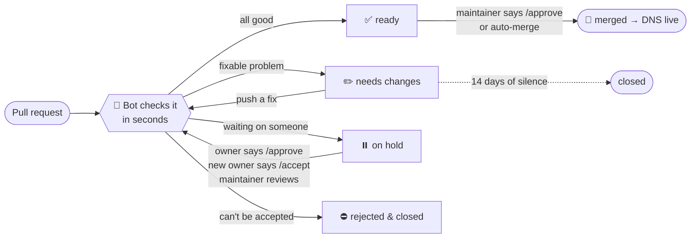

<p align="center">
  
</p>

<p align="center">
  <a href="https://github.com/So10-k/awesomeprojects.tech/actions/workflows/deploy.yml"></a>
  <a href="domains/"></a>
  <a href="https://github.com/So10-k/awesomeprojects.tech/pulls"></a>
</p>

<p align="center">
  <b>Got a project? Give it a name.</b><br>
  Open one pull request and get <code>yourname.awesomeprojects.tech</code>. A bot checks your request in seconds, and it goes live minutes after it's approved.
</p>

<p align="center">
  <a href="#-get-your-subdomain"><b>Get one</b></a> ·
  <a href="#-how-a-request-flows"><b>How it works</b></a> ·
  <a href="#-change-transfer-or-remove-yours"><b>Transfer / remove</b></a> ·
  <a href="#-rules"><b>Rules</b></a> ·
  <a href="#-faq"><b>FAQ</b></a>
</p>

---

## 🚀 Get your subdomain

**1. Set up your site first.** GitHub Pages, Vercel, Netlify, your own server: anything works.

**2. Add a file.** [Create `domains/<name>.json`](../../new/main/domains?filename=yourname.json) right in your browser. GitHub forks the repo for you.

```json
{
  "owner": { "github": "your-github-username" },
  "description": "My portfolio",
  "records": { "CNAME": "your-github-username.github.io" }
}
```

**3. Open the pull request.** Within seconds the bot replies with something like this:

> ## ✅ Ready to go live
> | | Check | Result |
> |:-:|---|---|
> | ✅ | **Format & records** | Valid |
> | ✅ | **Ownership** | Yours |
> | ✅ | **Account age** | 4 years old |
> | ✅ | **Bot check** | Looks like a real person |
> | ✅ | **Subdomains you own** | 1 of 3 |
> | ✅ | **Name check** | OK |
> | ✅ | **Target is live** | `you.github.io` resolves |
> | ✅ | **Consent** | Nothing needed |

**4. That's it.** A maintainer gives it a final look, and DNS updates about a minute after it's merged.

<details>
<summary><b>🧩 Every record type, with examples</b></summary>

| Type | What it's for | Example |
|---|---|---|
| `CNAME` | Point at another hostname (can't be mixed with other types) | `"CNAME": "you.github.io"` |
| `A` | Point at IPv4 addresses | `"A": ["76.76.21.21"]` |
| `AAAA` | Point at IPv6 addresses | `"AAAA": ["2606:4700::6810:84e5"]` |
| `TXT` | Verification strings | `"TXT": ["google-site-verification=abc123"]` |
| `MX` | Receive email | `"MX": [{ "host": "mx1.improvmx.com", "priority": 10 }]` |

Only public IPs. No `NS` records (handing the name to another DNS server) and no wildcards.

</details>

<details>
<summary><b>⚡ Setup for popular hosts</b></summary>

| Host | Record | Then… |
|---|---|---|
| **GitHub Pages** | `"CNAME": "<you>.github.io"` | Repo → Settings → Pages → Custom domain → `<name>.awesomeprojects.tech` |
| **Vercel** | `"CNAME": "cname.vercel-dns.com"` | Project → Settings → Domains → add it. If Vercel asks for a TXT, add `_vercel.<name>.json` |
| **Netlify** | `"CNAME": "<site>.netlify.app"` | Site → Domain management → add it |
| **Cloudflare Pages** | `"CNAME": "<project>.pages.dev"` | Project → Custom domains → add it |
| **Render / Railway / Fly** | `"CNAME": "<app>.onrender.com"` etc. | Add the custom domain in the dashboard |
| **Your own server** | `"A": ["<your IPv4>"]` | Point your web server at the name, then get a certificate (e.g. Caddy or certbot) |

</details>

<details>
<summary><b>🔐 Verification records & names under yours</b></summary>

Anything **under** your name gets its own file:

```text
domains/alice.json                                  alice.awesomeprojects.tech
domains/_vercel.alice.json                          _vercel.alice.awesomeprojects.tech       (TXT)
domains/_github-pages-challenge-alice.alice.json    GitHub Pages domain verification
domains/s1._domainkey.alice.json                    email DKIM
domains/blog.alice.json                             blog.alice.awesomeprojects.tech
```

Names under yours don't count toward your limit. If **someone else** wants a name under yours (say `docs.alice`), their request waits until you comment `/approve` on it.

</details>

---

## 🧭 How a request flows



**What the bot checks**

| Check | ✅ Passes when | ⏸️ Holds when | ✏️ / ⛔ Fails when |
|---|---|---|---|
| **Format & records** | the JSON and records are valid | | ✏️ invalid JSON, private IPs, bad names, files outside `domains/` |
| **Ownership** | `owner.github` is you | | ✏️ it's someone else · ⛔ you edit a name you don't own |
| **Account age** | older than 30 days | 7–30 days old | ⛔ under 7 days (it tells you when to come back) |
| **Bot check** | it looks like a real person | it looks like a throwaway account | ⛔ bot accounts |
| **Subdomains you own** | within the limit (3) | | ✏️ over the limit |
| **Name check** | | the name looks like phishing (`login`, `paypal`…) | ✏️ reserved names |
| **Target is live** | the CNAME/MX target resolves | GitHub Pages target isn't yours | ✏️ the target doesn't exist |
| **Consent** | nothing needed, or given | under someone else's name, or a hand-over | |

---

## 🔁 Change, transfer or remove yours

| I want to… | Do this |
|---|---|
| **Point it somewhere else** | Edit your file in a PR. Same checks, usually instant. |
| **Give it to someone** | [Open a transfer](../../issues/new?template=transfer.yml) with their username. They reply `/accept`, and it moves automatically. |
| **Get a name someone else has** | [Open a transfer](../../issues/new?template=transfer.yml) and leave the new owner blank. The owner gets pinged and replies `/approve`. If they've vanished, a maintainer can step in after 30 days. |
| **Remove mine** | [Open a takedown](../../issues/new?template=takedown.yml) → "I own it and want it removed". Removed automatically, right away. |
| **Report abuse** | [Open a takedown](../../issues/new?template=takedown.yml) with the reason. For something sensitive, [report it privately](../../security/advisories/new). |

---

## 📜 Rules

1. **Real projects only.** No phishing, scams, malware, spam, adult content, impersonation, or anything illegal.
2. **Three names per person.** Names under yours (`blog.you`, `_vercel.you`) don't count.
3. **Don't leave it dangling.** If your site goes away, remove your name. A weekly health check flags names that point at nothing, because those can be hijacked.
4. **Accounts must be at least a week old.** Accounts under a month old, and ones that look automated, get a human review.
5. **We can remove anything, any time.** It's a free service run by volunteers.

---

## ❓ FAQ

<details><summary><b>How long does it take?</b></summary>
The bot answers in seconds. A maintainer usually reviews within a day. After merge, DNS updates within a minute or two (your host may take a few more minutes to issue HTTPS).
</details>

<details><summary><b>The bot says my target doesn't exist</b></summary>
Set up the site first, so the name never points at nothing. Then push any change, or comment <code>/recheck</code>.
</details>

<details><summary><b>Can I use Cloudflare's proxy / orange cloud?</b></summary>
No. Records are DNS-only, so your host handles HTTPS.
</details>

<details><summary><b>Can I get a wildcard or NS records?</b></summary>
No. Those would hand control of a whole branch of the domain to one server, so they aren't offered.
</details>

<details><summary><b>Why did my request get held?</b></summary>
Nothing's wrong. A person needs to look at it: either the owner of the name above yours, the new owner in a hand-over, or a maintainer (for new accounts, names that look like phishing, or GitHub Pages targets that aren't yours).
</details>

---

<p align="center">
  <sub>Run by volunteers · <a href="docs/MAINTAINERS.md">Maintainer guide</a> · DNS by Cloudflare, managed with <a href="https://dnscontrol.org">DNSControl</a></sub>
</p>
