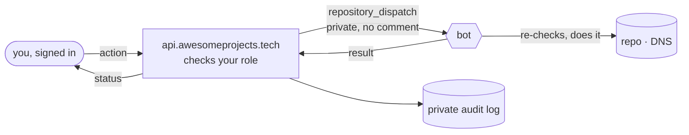

# The panel server (`api.awesomeprojects.tech`)

A small Cloudflare Worker (`worker/`) behind **Sign in with GitHub** on the [console](https://awesomeprojects.tech/admin/) and [My domains](https://awesomeprojects.tech/me/).



- **Sign-in** is GitHub OAuth with **no scopes**: GitHub tells the Worker who you are, and that's all. Its token is thrown away right after.
- **Sessions** are signed bearer tokens the page keeps in your browser (12 hours), never cookies. Every `*.awesomeprojects.tech` site is "same-site" with the API, so a cookie could be ridden by someone's subdomain; a bearer token can't.
- **Actions** are structured (`{ action: "ban", args: { user, reason } }`), validated, rate-limited (40 per 10 min each), and sent to the bot with `repository_dispatch`. Nothing is posted publicly, except where it has to be: approving a request still tells the requester on their issue.
- **The bot is the authority.** It re-checks roles and ownership from `main`'s `config.json` and `domains/` before doing anything, so even a compromised Worker can't make a non-maintainer a maintainer.
- **Audit log:** every action, who did it, and how it went, kept privately in Workers KV (shown in the console's *Activity* tab, maintainers only). The public 📜 activity log still gets one line per change.
- **Fallbacks:** if the Worker is down, the console offers token mode (actions as comments), and slash commands always work.

- **Private requests** live in a D1 database (Cloudflare's SQLite): the request, the bot's review, a conversation with optional maintainers-only notes, and who decided what. Only the requester and maintainers can read one. Requests opened as public GitHub issues still work too.

Cost: Cloudflare Workers + KV + D1 free tiers (100k requests/day).

## One-time setup (about 10 minutes)

### 1. A GitHub OAuth app

[github.com/settings/applications/new](https://github.com/settings/applications/new):

| Field | Value |
|---|---|
| Application name | `awesomeprojects.tech` |
| Homepage URL | `https://awesomeprojects.tech` |
| Authorization callback URL | `https://api.awesomeprojects.tech/auth/callback` |
| Enable Device Flow | off |

Create it, copy the **Client ID**, then **Generate a new client secret** and copy it.

### 2. A token for sending actions to the bot

[Fine-grained token](https://github.com/settings/personal-access-tokens/new): *Resource owner* So10-k · *Only select repositories* → `awesomeprojects.tech` · *Repository permissions*: **Contents: Read and write** (needed to send `repository_dispatch`), **Issues: Read-only** (the console's queue). Expiry: up to you; when it expires, the panel stops until you replace the secret.

### 3. A Cloudflare token for deploying the Worker

Cloudflare → My Profile → API Tokens → **Create Token** → template **Edit Cloudflare Workers** → *Account resources*: your account · *Zone resources*: `awesomeprojects.tech`. Then **add one permission**: *Account → D1 → Edit* (the template doesn't include it, and private requests need it). The DNS token stays DNS-only.

### 4. Repository secrets

In a terminal, from anywhere (`gh` prompts for each value, so nothing lands in your shell history):

```bash
gh secret set PANEL_GITHUB_CLIENT_ID -R So10-k/awesomeprojects.tech
```
```bash
gh secret set PANEL_GITHUB_CLIENT_SECRET -R So10-k/awesomeprojects.tech
```
```bash
gh secret set PANEL_DISPATCH_TOKEN -R So10-k/awesomeprojects.tech
```
```bash
gh secret set CLOUDFLARE_WORKERS_TOKEN -R So10-k/awesomeprojects.tech
```

And two random secrets (generated and stored directly, never shown):

```bash
openssl rand -hex 32 | gh secret set PANEL_SESSION_SECRET -R So10-k/awesomeprojects.tech
```
```bash
openssl rand -hex 32 | gh secret set PANEL_BOT_SECRET -R So10-k/awesomeprojects.tech
```

### 5. Deploy

```bash
gh workflow run panel.yml -R So10-k/awesomeprojects.tech
```

It creates the KV namespace, deploys the Worker on `api.awesomeprojects.tech` (Cloudflare adds that DNS record itself; `api` is reserved, so DNSControl leaves it alone), sets the secrets, and checks `/health`. Then open [awesomeprojects.tech/admin](https://awesomeprojects.tech/admin/) → **Sign in with GitHub**.

## Changing things later

- **Code:** edit `worker/src/index.js`; merging to `main` redeploys. Tests: `test/worker.test.mjs` (`npm test`).
- **Rotating a secret:** set it again with `gh secret set …`, then re-run *Panel server*. Rotating `PANEL_SESSION_SECRET` signs everyone out.
- **Turning it off:** Cloudflare → Workers → `awesomeprojects-panel` → disable, or delete it. The console falls back to token mode on its own.
- **Local dev:** `cd worker && npx wrangler dev --local --var SESSION_SECRET:dev …` (the `EXTRA_ORIGINS` var already allows `http://localhost:5191`).
